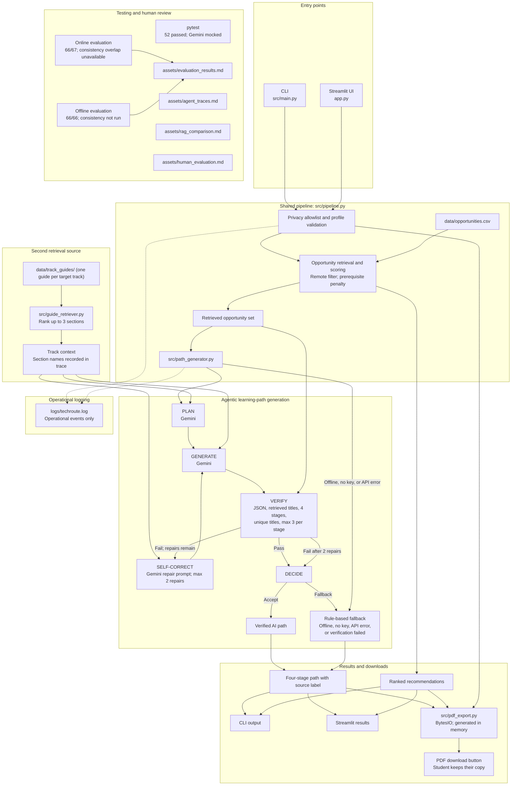

# TechRoute Recommender

## 1. Title and Summary

TechRoute Recommender is an applied AI system that helps students find a route into tech. A student chooses learning preferences—target track, format, skill level, free and remote needs, weekly hours, and interests—and gets ranked free or low-cost opportunities plus a four-stage learning path: **Foundations, Build Skills, Prove Skills, Apply**. Internship and job opportunities appear in the path when available in the retrieved dataset.

Students, especially career changers and first-generation students, often face scattered resources and paid-course noise. TechRoute brings relevant options into an explainable path, with no login and no personal data fields in its supported profiles. Unexpected profile keys are discarded before a prompt is built.

## 2. Original Project (Base Project)

The base project was **Project 3: Show What You Know: Music Recommender Simulation** (CodePath AI110). It simulated how music platforms recommend songs using a modular Python weighted-score recommender: song attributes such as genre, mood, and energy were compared with a user taste profile to produce ranked suggestions. The original exercise also included a model-card component discussing risks such as filter bubbles.

TechRoute keeps the weighted-scoring core, replaces songs with a curated tech-opportunity dataset, and adds input guardrails, track-guide retrieval, and an agentic Gemini path generator with planning, verification, up to two repair attempts, and a rule-based fallback. The Streamlit UI and CLI share `src/pipeline.py`; the UI can also generate a downloadable PDF entirely in memory.

## 3. Architecture Overview

The CLI and Streamlit UI are two entry points to the shared pipeline. It validates the learning profile, applies the existing remote and prerequisite guardrails, and ranks opportunities from `data/opportunities.csv`. For AI generation, a guide retriever can add relevant sections from `data/track_guides/` as context; guide text is not an opportunity source. Gemini plans and generates a four-stage path, the verifier checks its structure and retrieved titles, and Gemini may be asked to repair a rejected path up to two times. The decision step accepts a verified path or selects the rule-based fallback with a visible reason. The UI also offers an in-memory PDF download.



Diagram source: [diagrams/architecture.mmd](diagrams/architecture.mmd). The human evaluation file is present; agent traces, the guide comparison, and the evaluation report are committed evidence.

Automated checks live in `tests/` and `scripts/evaluate_reliability.py`. Human review is recorded in [assets/human_evaluation.md](assets/human_evaluation.md); real agent runs and the guide comparison are in [assets/agent_traces.md](assets/agent_traces.md) and [assets/rag_comparison.md](assets/rag_comparison.md).

## 4. Setup Instructions

### Prerequisites

The repository was run with **Python 3.12.10**. It does not declare a broader supported Python version range.

### Clone and install

**Windows PowerShell**

```powershell
git clone https://github.com/AxmadMC/techroute-recommender.git
cd techroute-recommender
py -3.12 -m venv .venv
.\.venv\Scripts\Activate.ps1
python -m pip install -r requirements.txt
```

**macOS or Linux**

```bash
git clone https://github.com/AxmadMC/techroute-recommender.git
cd techroute-recommender
python3.12 -m venv .venv
source .venv/bin/activate
python -m pip install -r requirements.txt
```

### Optional Gemini configuration

To use Gemini, copy `.env.example` to `.env` and set `GEMINI_API_KEY` using [Google AI Studio](https://aistudio.google.com/apikey). The default model is `gemini-3.1-flash-lite`; `GEMINI_MODEL` can override it. The `.env` file is ignored by Git. Without a key, or if a Gemini call or its output fails verification, the app uses the rule-based fallback. The dataset file must still be available.

### Run the CLI

```bash
python -m src.main
python -m src.main --list-profiles
python -m src.main --profile cloud_career_changer
python -m src.main --profile cybersecurity_beginner --offline
python -m src.main --profile ai_engineering_student --trace
python -m src.main --profile networking_student --no-guides
```

With no options, the CLI uses the `software_engineering_student` preset.

`--trace` prints the agent steps after the learning path. `--no-guides` disables track-guide context for comparison. The Streamlit UI provides the same recommendations and path and a **Download my route (PDF)** button; the PDF is generated in memory and downloaded by the student.

### Run the Web App

```bash
streamlit run app.py
```

The app has a preferences form and Learning Path, Recommendations, and How it works & privacy tabs. It offers optional Gemini generation, ranked score explanations, and an in-memory PDF download. It requires no login and does not save submitted profiles, routes, or PDFs; the existing operational logs are the only app data written to disk. When AI is enabled, learning preferences and retrieved opportunity details are sent to Gemini.

The interface uses native Streamlit controls for keyboard operation, a blue/orange status palette with text labels and symbols (not color alone), and a 16px base font. Its reported foreground/background contrast pairs range from 4.56:1 to 12.32:1, meeting WCAG AA text contrast (4.5:1) and the UI-border threshold (3:1).

### Run tests and reliability evaluation

```bash
python -m pytest
python scripts/evaluate_reliability.py
python scripts/evaluate_reliability.py --offline
```

## 5. Sample Interactions

The CLI prints a machine-specific absolute dataset path when loading data. That line is omitted from these excerpts to avoid including a local account identifier. The displayed recommendation and path output is copied from [assets/sample_runs.md](assets/sample_runs.md); that file contains the full captured runs.

### Cloud career changer — Gemini

**Command:** `python -m src.main --profile cloud_career_changer`

**Input profile:**

```json
{
  "target_track": "cloud_computing",
  "preferred_format": "self_paced",
  "skill_level": 0.3,
  "prefers_free": true,
  "needs_remote": true,
  "max_hours": 10,
  "interests": [
    "azure",
    "cloud",
    "linux"
  ]
}
```

**CLI output:**

```text
Top opportunities:

AZ-900 learning paths - Score: 5.57
Because: career track match (+2.00); format matches 'self_paced' (+1.00); difficulty fit (+0.90); free priority (+1.00); Remote requirement met; remote preference match (+0.50); interest overlap (+0.17)

AWS Cloud Practitioner Essentials - Score: 5.40
Because: career track match (+2.00); format matches 'self_paced' (+1.00); difficulty fit (+0.90); free priority (+1.00); Remote requirement met; remote preference match (+0.50)

AWS Educate - Score: 5.40
Because: career track match (+2.00); format matches 'self_paced' (+1.00); difficulty fit (+0.90); free priority (+1.00); Remote requirement met; remote preference match (+0.50)

Home lab: static site on AWS or Azure free tier - Score: 5.17
Because: career track match (+2.00); difficulty fit (+1.00); free priority (+1.00); Remote requirement met; remote preference match (+0.50); time fit (+0.50); interest overlap (+0.17)

Azure Fundamentals AZ-900 - Score: 5.07
Because: career track match (+2.00); format matches 'self_paced' (+1.00); difficulty fit (+0.90); free priority (+0.50); Remote requirement met; remote preference match (+0.50); interest overlap (+0.17)

Privacy notice: only learning preferences (no personal data) and retrieved opportunity details are sent to Gemini.

Generated learning path - Source: Gemini (verified against retrieved data):

1. Foundations: Gain a broad understanding of cloud computing terminology and concepts.
   Opportunities: AZ-900 learning paths, AWS Cloud Practitioner Essentials
   Why: These resources establish the necessary baseline knowledge of cloud architecture and services required for beginners.
2. Build Skills: Develop hands-on experience and structured cloud engineering knowledge.
   Opportunities: AWS Educate, Cloud Engineering
   Why: Engaging with structured programs provides practical guided learning environments to deepen technical competencies.
3. Prove Skills: Validate your cloud proficiency through industry-recognized certification and practical application.
   Opportunities: Home lab: static site on AWS or Azure free tier, Azure Fundamentals AZ-900, AWS Certified Cloud Practitioner
   Why: Testing your knowledge through formal certification and applying it to a personal project proves capability to prospective environments.
4. Apply: Transition from learning to active professional roles.
   Why: No internship or job opportunities are in the dataset yet.
```

### Cybersecurity beginner — offline fallback

**Command:** `python -m src.main --profile cybersecurity_beginner --offline`

**Input profile:**

```json
{
  "target_track": "cybersecurity",
  "preferred_format": "self_paced",
  "skill_level": 0.2,
  "prefers_free": true,
  "needs_remote": true,
  "max_hours": 5,
  "interests": [
    "security_fundamentals",
    "linux",
    "networking"
  ]
}
```

**CLI output:**

```text
2026-11-14 22:38:38 WARNING gemini_call_skipped reason=no API key

Top opportunities:

CS50 Cybersecurity - Score: 5.57
Because: career track match (+2.00); format matches 'self_paced' (+1.00); difficulty fit (+0.90); free priority (+1.00); Remote requirement met; remote preference match (+0.50); interest overlap (+0.17)

Introduction to Cybersecurity - Score: 5.57
Because: career track match (+2.00); format matches 'self_paced' (+1.00); difficulty fit (+0.90); free priority (+1.00); Remote requirement met; remote preference match (+0.50); interest overlap (+0.17)

Junior Cybersecurity Analyst career path - Score: 5.57
Because: career track match (+2.00); format matches 'self_paced' (+1.00); difficulty fit (+0.90); free priority (+1.00); Remote requirement met; remote preference match (+0.50); interest overlap (+0.17)

CompTIA Security+ videos - Score: 5.57
Because: career track match (+2.00); format matches 'self_paced' (+1.00); difficulty fit (+0.90); free priority (+1.00); Remote requirement met; remote preference match (+0.50); interest overlap (+0.17)

Cyber Security 101 - Score: 5.50
Because: career track match (+2.00); format matches 'self_paced' (+1.00); difficulty fit (+1.00); free priority (+0.50); Remote requirement met; remote preference match (+0.50); interest overlap (+0.50)

Privacy notice: only learning preferences (no personal data) are used; offline mode sends no data to Gemini.

Generated learning path - Source: rule-based fallback (reason: offline mode):

1. Foundations: Build foundational knowledge from retrieved learning resources.
   Opportunities: Introduction to Cybersecurity, Pre Security, Cyber Security 101, CS50 Cybersecurity, CompTIA Security+ videos, Junior Cybersecurity Analyst career path
   Why: Begin with courses and other foundational learning resources.
2. Build Skills: Practice with retrieved tools and hands-on labs.
   Why: These retrieved resources provide practical tool or lab experience.
3. Prove Skills: Demonstrate skills with retrieved projects and credentials.
   Opportunities: OverTheWire Bandit, Security Compliance and Identity Fundamentals SC-900
   Why: Projects, certifications, and contributions can demonstrate progress.
4. Apply: No internship or job opportunities are in the dataset yet for this track.
   Why: No matching internship or job rows were retrieved.
```

### Unknown profile — guardrail

**Command:** `python -m src.main --profile not_a_real_profile`

**Input profile:** `not_a_real_profile` (no matching preset)

**CLI output:**

```text
Error: unknown profile 'not_a_real_profile'. Valid profile names: it_support_beginner, networking_student, cybersecurity_beginner, cloud_career_changer, ai_engineering_student, software_engineering_student
```

For the complete captured output, see [assets/sample_runs.md](assets/sample_runs.md).

### AI Engineering student — agent trace

**Command:** `python -m src.main --profile ai_engineering_student --trace`

The CLI prints a concise plain-language rendering of the trace. The following saved trace record is copied from [assets/agent_traces.md](assets/agent_traces.md):

```json
[
  {
    "step_name": "PLAN",
    "attempt_number": 1,
    "decision": "accepted",
    "verifier_errors": [],
    "detail": "Created a plan for 4 retrieved opportunities.",
    "plan": [
      {
        "title": "AI Engineer",
        "stage": "Foundations",
        "reason": "It provides a structured roadmap to align with your target track as a beginner."
      },
      {
        "title": "Kaggle Learn Python Pandas and Intro to Machine Learning",
        "stage": "Foundations",
        "reason": "This course builds essential Python and machine learning basics through a preferred free and remote format."
      },
      {
        "title": "Data Analysis with Python",
        "stage": "Build Skills",
        "reason": "This certification allows for deep technical skill development in your primary interest area."
      },
      {
        "title": "Titanic competition",
        "stage": "Prove Skills",
        "reason": "This project offers a practical, competition-based environment to test data analysis skills."
      }
    ]
  },
  {
    "step_name": "GENERATE",
    "attempt_number": 1,
    "decision": "draft_received",
    "verifier_errors": [],
    "detail": "Received the initial path draft."
  },
  {
    "step_name": "VERIFY",
    "attempt_number": 1,
    "decision": "accepted",
    "verifier_errors": [],
    "detail": "Valid JSON, retrieved titles, stage order, uniqueness, and stage-size limits passed."
  },
  {
    "step_name": "DECIDE",
    "attempt_number": 1,
    "decision": "accepted",
    "verifier_errors": [],
    "detail": "AI-generated path accepted after 0 self-correction(s).",
    "repair_attempts": 0
  }
]
```

## 6. Design Decisions and Trade-offs

- **Rule-based retrieval, LLM-written path:** Ranking uses explicit weighted factors—track match, format match, difficulty fit, free priority, remote match, time fit, and interest overlap. Each recommendation includes its score factors. Gemini writes a path using retrieved items; it does not choose from the full dataset itself.
- **Output verification:** The response must parse as JSON and every opportunity title must match the retrieved set. Invalid or ungrounded output is rejected and replaced by a rule-based path, preventing invented courses, internships, or jobs from appearing as recommendations.
- **Visible fallback:** Missing keys, API errors, rejected output, and offline mode have visible fallback reasons. The dataset is still required.
- **Guardrails:** `needs_remote` is a hard filter. An opportunity tagged `prior_experience` receives a visible `-1.0` score penalty for users with `skill_level < 0.5`; it remains available so beginners can see a possible next step.
- **Privacy:** There is no login, and the app does not save student profiles or generated paths. Only allowlisted learning preferences are used in a Gemini prompt; unexpected keys are dropped. Logs contain operational fields such as event names, counts, track, and reasons—not the API key, full profile, prompt, or full AI response. When a key is used, learning preferences and retrieved opportunity details are sent to Google's Gemini API.
- **Model choice:** The default is `gemini-3.1-flash-lite`, selected as a fast, low-cost model for this simple generation task. The output is verified independently of the model.
- **Known trade-offs:** The catalog is small and manually assembled: 87 rows. All 87 `last_verified` cells are blank, so verification dates are not recorded. Hand-tuned weights can produce frequent score ties, and the catalog contains near-duplicates such as “AZ-900 learning paths” and “Azure Fundamentals AZ-900.” `max_hours` is a soft scoring bonus, not a hard time limit.

## 7. Testing Summary

- **Unit tests:** The fresh `python -m pytest` run passed 52 tests. Gemini behavior is mocked; tests do not call the real API.
- **Reliability evaluation:** On 2026-11-15, online passed 66/67 checks (98.5%); offline passed 66/66 (100%). The latest online consistency overlap was unavailable because one Cloud comparison path fell back after two repair attempts. See [assets/evaluation_results.md](assets/evaluation_results.md).
- **What worked:** The remote hard filter, grounded-title checks, and fallback paths passed the scripted checks. The low-skill prior-experience penalty moved the tagged AZ-104 learning-path opportunity out of the Cloud career changer's top five.
- **What needed fixing or remains limited:** Testing found that `prefers_free` could be accepted but ignored; free-priority scoring was corrected and regression-tested. Score ties and near-duplicates remain, and `max_hours` is only a soft bonus. The checks were written after observing the recommender, so these pass rates are not proof of real-world quality.
- **What I learned:** A realistic test profile can expose ranking gaps that a successful CLI run hides. Good evaluation needs explicit constraints and adversarial cases, not only plausible-looking recommendations.

## Reliability and Guardrail Results

Fresh results from 2026-11-15:

```text
Unit tests: 52 passed
Online reliability: 66/67 checks passed (98.5%); 1 failed
Offline reliability: 66/66 checks passed (100.0%)
Online consistency: overlap unavailable; one Cloud run fell back after 2 repair attempts
Offline consistency: not run
Agent repairs: 0 across the six preset-profile paths in the latest online run; 2 attempts in its Cloud consistency rerun, followed by fallback
```

The failed online check is reported rather than hidden: the Jaccard overlap could not be calculated because the two Cloud paths were not both Gemini-generated.

## Stretch Features

### Test Harness / Evaluation Script

[`scripts/evaluate_reliability.py`](scripts/evaluate_reliability.py) checks track relevance, remote and prerequisite guardrails, result count, retrieved-title grounding, path structure, Apply-step behavior, source labels, agent stage size, and duplicate titles. Fresh pass rates and captured runs: [assets/evaluation_results.md](assets/evaluation_results.md).

### Agentic Workflow

The generator plans, generates, verifies, and can request up to two self-corrections before selecting a verified path or fallback. Real traces: [assets/agent_traces.md](assets/agent_traces.md); Task SF8 prompt and collaboration notes: [ai_interactions.md](ai_interactions.md).

### RAG Enhancement

Track guides provide a second retrieval source for contextual goals and explanations; opportunity titles still must come from the opportunity retrieval set. The before/after results for three profiles are in [assets/rag_comparison.md](assets/rag_comparison.md).

## What This Project Says About Me as an AI Engineer

Finishing CodePath AI110 means a lot to me: I built my AI engineering foundation entirely through free learning, which is exactly the route TechRoute is designed to help other students find. This project shows how I approach AI engineering: I don’t trust the model by default. I ground it in retrieved data, verify its output, give it a safe fallback, and measure it honestly, including the results that didn’t pass, like the consistency check. I also designed for the people using it: no login, no stored data, and an accessible interface. I’m a self-taught career changer, and this project shows I can take an idea from a simple recommender to a tested, documented AI system that I can explain and defend.

## 8. Reflection

This project taught me that reliability came from the checks around the model, not the model itself. Testing exposed gaps that looked fine on the surface, and made data quality and clear explanations as important as generated text. A passing scripted evaluation is useful evidence of expected behavior, but it does not establish that the recommendations work for every student.

The [model_card.md](model_card.md) records the current system, evaluation evidence, limitations, and responsible-use considerations.

## 9. Project Structure

```text
.
├── .streamlit/
│   └── config.toml
├── app.py
├── assets/
│   ├── agent_traces.md
│   ├── evaluation_results.md
│   ├── fonts/
│   │   ├── DejaVuSans-Bold.ttf
│   │   ├── DejaVuSans.ttf
│   │   └── LICENSE.txt
│   ├── human_evaluation.md
│   ├── rag_comparison.md
│   └── sample_runs.md
├── data/
│   ├── opportunities.csv
│   └── track_guides/
│       ├── ai_engineering.md
│       ├── cloud_computing.md
│       ├── cybersecurity.md
│       ├── general.md
│       ├── hardware_repair.md
│       ├── it_support.md
│       ├── networking.md
│       ├── software_engineering.md
│       └── web_development.md
├── diagrams/
│   └── architecture.mmd
├── docs/
│   └── dataset_requirements.md
├── scripts/
│   ├── compare_rag.py
│   ├── evaluate_reliability.py
│   └── generate_agent_traces.py
├── src/
│   ├── guide_retriever.py
│   ├── logging_config.py
│   ├── main.py
│   ├── path_generator.py
│   ├── pdf_export.py
│   ├── pipeline.py
│   ├── profiles.py
│   └── recommender.py
├── tests/
│   ├── test_evaluate_reliability.py
│   ├── test_guide_retriever.py
│   ├── test_main.py
│   ├── test_path_generator.py
│   ├── test_pdf_export.py
│   ├── test_pipeline.py
│   └── test_recommender.py
├── .env.example
├── model_card.md
├── pytest.ini
├── requirements.txt
└── README.md
```

## Author

Ahmed Ali, Web Developer

- Website: https://ahmedmc.com
- GitHub: https://github.com/AxmadMC
- LinkedIn: https://www.linkedin.com/in/ahmadmc/
