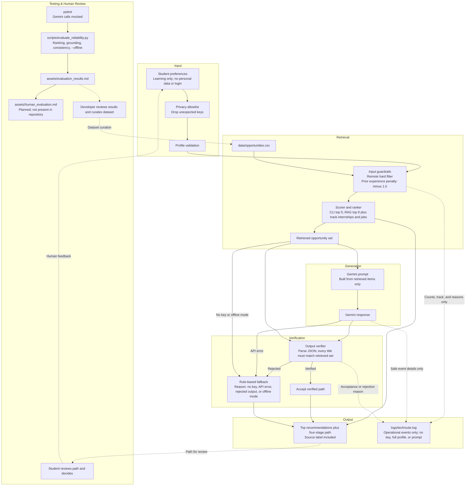

# TechRoute Recommender

## 1. Title and Summary

TechRoute Recommender is an applied AI system that helps students find a route into tech. A student chooses learning preferences—target track, format, skill level, free and remote needs, weekly hours, and interests—and gets ranked free or low-cost opportunities plus a four-stage learning path: **Foundations, Build Skills, Prove Skills, Apply**. Internship and job opportunities appear in the path when available in the retrieved dataset.

Students, especially career changers and first-generation students, often face scattered resources and paid-course noise. TechRoute brings relevant options into an explainable path, with no login and no personal data fields in its supported profiles. Unexpected profile keys are discarded before a prompt is built.

## 2. Original Project (Base Project)

The base project was **Project 3: Show What You Know: Music Recommender Simulation** (CodePath AI110). It simulated how music platforms recommend songs using a modular Python weighted-score recommender: song attributes such as genre, mood, and energy were compared with a user taste profile to produce ranked suggestions. The original exercise also included a model-card component discussing risks such as filter bubbles.

TechRoute keeps the weighted-scoring core, replaces songs with a curated tech-opportunity dataset, and adds input guardrails, Gemini-based retrieval-augmented generation (RAG) with output verification, logging, and a reproducible reliability evaluation.

## 3. Architecture Overview

The CLI accepts a preset learning profile. The profile is allowlisted and validated, then the recommender applies remote and prerequisite guardrails and ranks opportunities from `data/opportunities.csv`. Gemini is prompted with only the learning preferences and retrieved opportunity details; the response is parsed and checked against the retrieved titles. A verified path is accepted, otherwise a rule-based path is used with a visible fallback reason. The CLI shows top recommendations and the four-stage path with its source label.



Diagram source: [diagrams/architecture.mmd](diagrams/architecture.mmd).

Automated checks live in `tests/` and `scripts/evaluate_reliability.py`; evaluation outputs are saved in [assets/evaluation_results.md](assets/evaluation_results.md). A student can review a generated path and decide whether it suits their goals. Developers can inspect evaluation results and curate the dataset. The architecture marks `assets/human_evaluation.md` as planned; that file is not currently present.

## 4. Setup Instructions

### Prerequisites

The repository was run with **Python 3.12.10**. It does not declare a broader supported Python version range.

### Clone and install

**Windows PowerShell**

```powershell
git clone https://github.com/AxmadMC/techroute-recommender.git
cd techroute-recommender
py -3.12 -m venv .venv
.\.venv\Scripts\Activate.ps1
python -m pip install -r requirements.txt
```

**macOS or Linux**

```bash
git clone https://github.com/AxmadMC/techroute-recommender.git
cd techroute-recommender
python3.12 -m venv .venv
source .venv/bin/activate
python -m pip install -r requirements.txt
```

### Optional Gemini configuration

To use Gemini, copy `.env.example` to `.env` and set `GEMINI_API_KEY` using [Google AI Studio](https://aistudio.google.com/apikey). The default model is `gemini-3.1-flash-lite`; `GEMINI_MODEL` can override it. The `.env` file is ignored by Git. Without a key, or if a Gemini call or its output fails verification, the app uses the rule-based fallback. The dataset file must still be available.

### Run the CLI

```bash
python -m src.main
python -m src.main --list-profiles
python -m src.main --profile cloud_career_changer
python -m src.main --profile cybersecurity_beginner --offline
```

With no options, the CLI uses the `software_engineering_student` preset.

### Run tests and reliability evaluation

```bash
python -m pytest
python scripts/evaluate_reliability.py
python scripts/evaluate_reliability.py --offline
```

## 5. Sample Interactions

The CLI prints a machine-specific absolute dataset path when loading data. That line is omitted from these excerpts to avoid including a local account identifier. The displayed recommendation and path output is copied from [assets/sample_runs.md](assets/sample_runs.md); that file contains the full captured runs.

### Cloud career changer — Gemini

**Command:** `python -m src.main --profile cloud_career_changer`

**Input profile:**

```json
{
  "target_track": "cloud_computing",
  "preferred_format": "self_paced",
  "skill_level": 0.3,
  "prefers_free": true,
  "needs_remote": true,
  "max_hours": 10,
  "interests": [
    "azure",
    "cloud",
    "linux"
  ]
}
```

**CLI output:**

```text
Top opportunities:

AZ-900 learning paths - Score: 5.57
Because: career track match (+2.00); format matches 'self_paced' (+1.00); difficulty fit (+0.90); free priority (+1.00); Remote requirement met; remote preference match (+0.50); interest overlap (+0.17)

AWS Cloud Practitioner Essentials - Score: 5.40
Because: career track match (+2.00); format matches 'self_paced' (+1.00); difficulty fit (+0.90); free priority (+1.00); Remote requirement met; remote preference match (+0.50)

AWS Educate - Score: 5.40
Because: career track match (+2.00); format matches 'self_paced' (+1.00); difficulty fit (+0.90); free priority (+1.00); Remote requirement met; remote preference match (+0.50)

Home lab: static site on AWS or Azure free tier - Score: 5.17
Because: career track match (+2.00); difficulty fit (+1.00); free priority (+1.00); Remote requirement met; remote preference match (+0.50); time fit (+0.50); interest overlap (+0.17)

Azure Fundamentals AZ-900 - Score: 5.07
Because: career track match (+2.00); format matches 'self_paced' (+1.00); difficulty fit (+0.90); free priority (+0.50); Remote requirement met; remote preference match (+0.50); interest overlap (+0.17)

Privacy notice: only learning preferences (no personal data) and retrieved opportunity details are sent to Gemini.

Generated learning path - Source: Gemini (verified against retrieved data):

1. Foundations: Gain a broad understanding of cloud computing terminology and concepts.
   Opportunities: AZ-900 learning paths, AWS Cloud Practitioner Essentials
   Why: These resources establish the necessary baseline knowledge of cloud architecture and services required for beginners.
2. Build Skills: Develop hands-on experience and structured cloud engineering knowledge.
   Opportunities: AWS Educate, Cloud Engineering
   Why: Engaging with structured programs provides practical guided learning environments to deepen technical competencies.
3. Prove Skills: Validate your cloud proficiency through industry-recognized certification and practical application.
   Opportunities: Home lab: static site on AWS or Azure free tier, Azure Fundamentals AZ-900, AWS Certified Cloud Practitioner
   Why: Testing your knowledge through formal certification and applying it to a personal project proves capability to prospective environments.
4. Apply: Transition from learning to active professional roles.
   Why: No internship or job opportunities are in the dataset yet.
```

### Cybersecurity beginner — offline fallback

**Command:** `python -m src.main --profile cybersecurity_beginner --offline`

**Input profile:**

```json
{
  "target_track": "cybersecurity",
  "preferred_format": "self_paced",
  "skill_level": 0.2,
  "prefers_free": true,
  "needs_remote": true,
  "max_hours": 5,
  "interests": [
    "security_fundamentals",
    "linux",
    "networking"
  ]
}
```

**CLI output:**

```text
2026-11-14 22:38:38 WARNING gemini_call_skipped reason=no API key

Top opportunities:

CS50 Cybersecurity - Score: 5.57
Because: career track match (+2.00); format matches 'self_paced' (+1.00); difficulty fit (+0.90); free priority (+1.00); Remote requirement met; remote preference match (+0.50); interest overlap (+0.17)

Introduction to Cybersecurity - Score: 5.57
Because: career track match (+2.00); format matches 'self_paced' (+1.00); difficulty fit (+0.90); free priority (+1.00); Remote requirement met; remote preference match (+0.50); interest overlap (+0.17)

Junior Cybersecurity Analyst career path - Score: 5.57
Because: career track match (+2.00); format matches 'self_paced' (+1.00); difficulty fit (+0.90); free priority (+1.00); Remote requirement met; remote preference match (+0.50); interest overlap (+0.17)

CompTIA Security+ videos - Score: 5.57
Because: career track match (+2.00); format matches 'self_paced' (+1.00); difficulty fit (+0.90); free priority (+1.00); Remote requirement met; remote preference match (+0.50); interest overlap (+0.17)

Cyber Security 101 - Score: 5.50
Because: career track match (+2.00); format matches 'self_paced' (+1.00); difficulty fit (+1.00); free priority (+0.50); Remote requirement met; remote preference match (+0.50); interest overlap (+0.50)

Privacy notice: only learning preferences (no personal data) are used; offline mode sends no data to Gemini.

Generated learning path - Source: rule-based fallback (reason: offline mode):

1. Foundations: Build foundational knowledge from retrieved learning resources.
   Opportunities: Introduction to Cybersecurity, Pre Security, Cyber Security 101, CS50 Cybersecurity, CompTIA Security+ videos, Junior Cybersecurity Analyst career path
   Why: Begin with courses and other foundational learning resources.
2. Build Skills: Practice with retrieved tools and hands-on labs.
   Why: These retrieved resources provide practical tool or lab experience.
3. Prove Skills: Demonstrate skills with retrieved projects and credentials.
   Opportunities: OverTheWire Bandit, Security Compliance and Identity Fundamentals SC-900
   Why: Projects, certifications, and contributions can demonstrate progress.
4. Apply: No internship or job opportunities are in the dataset yet for this track.
   Why: No matching internship or job rows were retrieved.
```

### Unknown profile — guardrail

**Command:** `python -m src.main --profile not_a_real_profile`

**Input profile:** `not_a_real_profile` (no matching preset)

**CLI output:**

```text
Error: unknown profile 'not_a_real_profile'. Valid profile names: it_support_beginner, networking_student, cybersecurity_beginner, cloud_career_changer, ai_engineering_student, software_engineering_student
```

For the complete captured output, see [assets/sample_runs.md](assets/sample_runs.md).

## 6. Design Decisions and Trade-offs

- **Rule-based retrieval, LLM-written path:** Ranking uses explicit weighted factors—track match, format match, difficulty fit, free priority, remote match, time fit, and interest overlap. Each recommendation includes its score factors. Gemini writes a path using retrieved items; it does not choose from the full dataset itself.
- **Output verification:** The response must parse as JSON and every opportunity title must match the retrieved set. Invalid or ungrounded output is rejected and replaced by a rule-based path, preventing invented courses, internships, or jobs from appearing as recommendations.
- **Visible fallback:** Missing keys, API errors, rejected output, and offline mode have visible fallback reasons. The dataset is still required.
- **Guardrails:** `needs_remote` is a hard filter. An opportunity tagged `prior_experience` receives a visible `-1.0` score penalty for users with `skill_level < 0.5`; it remains available so beginners can see a possible next step.
- **Privacy:** There is no login, and the app does not save student profiles or generated paths. Only allowlisted learning preferences are used in a Gemini prompt; unexpected keys are dropped. Logs contain operational fields such as event names, counts, track, and reasons—not the API key, full profile, prompt, or full AI response. When a key is used, learning preferences and retrieved opportunity details are sent to Google's Gemini API.
- **Model choice:** The default is `gemini-3.1-flash-lite`, selected as a fast, low-cost model for this simple generation task. The output is verified independently of the model.
- **Known trade-offs:** The catalog is small and manually assembled: 87 rows. All 87 `last_verified` cells are blank, so verification dates are not recorded. Hand-tuned weights can produce frequent score ties, and the catalog contains near-duplicates such as “AZ-900 learning paths” and “Azure Fundamentals AZ-900.” `max_hours` is a soft scoring bonus, not a hard time limit.

## 7. Testing Summary

- **Unit tests:** `python -m pytest` collects and passes 30 tests. Gemini behavior is mocked in tests; the test suite does not call the real API.
- **Reliability evaluation:** The saved results cover five profiles. The online run passed 41/41 checks (100%); the offline run passed 40/40 (100%). The two Cloud career changer Gemini paths had 100% title overlap under the evaluator's Jaccard comparison. See [assets/evaluation_results.md](assets/evaluation_results.md).
- **What worked:** The remote hard filter, grounded-title checks, and fallback paths passed the scripted checks. The low-skill prior-experience penalty moved the tagged AZ-104 learning-path opportunity out of the Cloud career changer's top five.
- **What needed fixing or remains limited:** Testing found that `prefers_free` could be accepted but ignored; free-priority scoring was corrected and regression-tested. Score ties and near-duplicates remain, and `max_hours` is only a soft bonus. The checks were written after observing the recommender, so a 100% pass rate is not proof of real-world quality.
- **What I learned:** A realistic test profile can expose ranking gaps that a successful CLI run hides. Good evaluation needs explicit constraints and adversarial cases, not only plausible-looking recommendations.

## 8. Reflection

This project taught me that reliability came from the checks around the model, not the model itself. Testing exposed gaps that looked fine on the surface, and made data quality and clear explanations as important as generated text. A passing scripted evaluation is useful evidence of expected behavior, but it does not establish that the recommendations work for every student.

The current [model_card.md](model_card.md) is still the Music Recommender starter template; the full responsible-AI reflection on AI collaboration, biases, limitations, and testing has not been written yet.

## 9. Project Structure

```text
.
├── assets/
│   ├── evaluation_results.md
│   └── sample_runs.md
├── data/
│   └── opportunities.csv
├── diagrams/
│   └── architecture.mmd
├── docs/
│   └── dataset_requirements.md
├── scripts/
│   └── evaluate_reliability.py
├── src/
│   ├── logging_config.py
│   ├── main.py
│   ├── path_generator.py
│   ├── profiles.py
│   └── recommender.py
├── tests/
│   ├── test_main.py
│   ├── test_path_generator.py
│   └── test_recommender.py
├── .env.example
├── model_card.md
├── pytest.ini
├── requirements.txt
└── README.md
```

## Author

Ahmed Ali, Web Developer

- Website: https://ahmedmc.com
- GitHub: https://github.com/AxmadMC
- LinkedIn: https://www.linkedin.com/in/ahmadmc/
